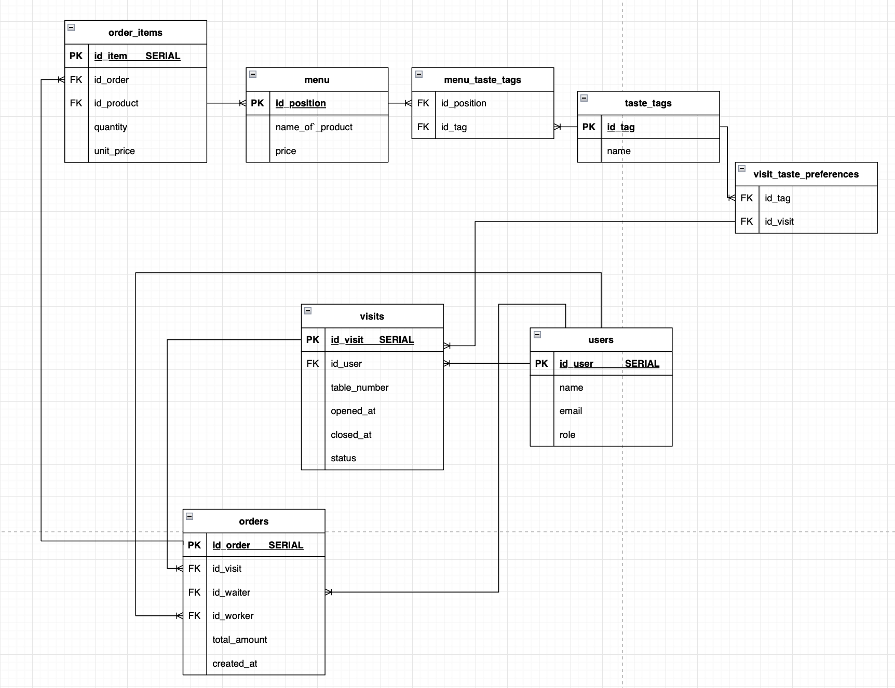

# «Северное сияние» — Cocktail Bar Backend

**Лабораторная работа №1 · Высоконагруженные системы · Монолитное приложение на Spring Boot**

«Северное сияние» — серверная часть информационной системы коктейльного бара. Приложение позволяет вести учёт посетителей, управлять коктейльным меню, фиксировать посещения, подбирать напитки по вкусовым предпочтениям и оформлять заказы.

Проект написан на **Kotlin** с использованием **Spring Boot**, **Spring Data JPA** и **PostgreSQL**. Приложение представляет собой единый монолит с REST API и разделением на контроллеры, сервисы, репозитории, сущности и DTO.

## Содержание

- [1. Техническое задание](#1-техническое-задание)
- [2. Описание разработанной системы](#2-описание-разработанной-системы)
- [3. Технологический стек](#3-технологический-стек)
- [4. Функциональные возможности](#4-функциональные-возможности)
- [5. Архитектура приложения](#5-архитектура-приложения)
- [6. Структура базы данных](#6-структура-базы-данных)
- [7. REST API](#7-rest-api)
- [8. Пагинация и рекомендации](#8-пагинация-и-рекомендации)
- [9. Транзакции](#9-транзакции)
- [10. Валидация и обработка ошибок](#10-валидация-и-обработка-ошибок)
- [11. Запуск приложения](#11-запуск-приложения)
- [12. Тестирование и покрытие](#12-тестирование-и-покрытие)
- [13. Организация разработки](#13-организация-разработки)

## 1. Техническое задание

**Оригинальное техническое задание лабораторной работы №1 (без изменений):**

[Лабораторная работа №1 — Discipliny/highload_systems](https://github.com/Discipliny/highload_systems#лабораторная-работа-1)

Исходная формулировка задания: «Написать монолит с использованием Spring Boot.»

Полные требования к технологиям, REST API, тестированию, транзакциям, пагинации, работе с базой данных, Docker Compose и Swagger приведены **в первоисточнике по ссылке выше**. Текст задания здесь не пересказывается и не изменяется; ниже отдельно описана выполненная реализация.

## 2. Описание разработанной системы

Предметная область — коктейльный бар. Один клиент может посещать бар многократно, во время каждого посещения выбирать вкусовые предпочтения и получать подходящие рекомендации. Официант оформляет заказ, а сотрудник бара назначается ответственным за его приготовление. Стоимость заказа рассчитывается автоматически.

Основные сущности системы:

| Сущность | Назначение |
| --- | --- |
| `User` | Посетитель или сотрудник бара |
| `MenuItem` | Коктейль, его стоимость, состав и вкусовые характеристики |
| `TasteTag` | Вкусовой тег коктейля |
| `Visit` | Посещение конкретного клиента |
| `Order` | Заказ, связанный с посещением и сотрудниками |
| `OrderItem` | Позиция заказа с количеством и зафиксированной ценой |

**Роли пользователей:**

- `CLIENT` — посетитель бара;
- `WAITER` — официант, который оформляет заказ;
- `WORKER` — сотрудник бара, выполняющий заказ.

При создании пользователя через REST API ему автоматически назначается роль `CLIENT`. Сервис проверяет роли `WAITER` и `WORKER` при создании заказа. Отдельного API для самостоятельного назначения ролей в первой лабораторной нет. Авторизация и аутентификация также не реализованы: роли используются в данных и бизнес-проверках, а не для защиты HTTP-эндпоинтов.

## 3. Технологический стек

| Компонент | Реализация |
| --- | --- |
| Язык | Kotlin 2.3.21 |
| Платформа | Java 21 |
| Фреймворк | Spring Boot 4.1.1 |
| Сборка | Maven |
| HTTP API | Spring Web MVC, REST |
| Доступ к данным | Spring Data JPA, Hibernate |
| База данных | PostgreSQL 17 |
| Миграции БД | Flyway |
| Валидация | Jakarta Bean Validation |
| Документация API | OpenAPI 3, Swagger UI (springdoc-openapi) |
| Модульное тестирование | JUnit Jupiter, Mockito |
| Интеграционное тестирование | JUnit Jupiter, Testcontainers, PostgreSQL |
| Покрытие | JaCoCo |
| Контейнеризация | Docker, Docker Compose |
| Версионирование | Git, GitHub, feature branches, Conventional Commits |

## 4. Функциональные возможности

### 4.1. Пользователи

Реализованы создание, получение по идентификатору, обновление и удаление пользователей. Проверяется уникальность электронной почты; имя и email проходят валидацию. При создании присваивается роль `CLIENT`. Отдельный эндпоинт для получения всех пользователей не предусмотрен.

### 4.2. Коктейльное меню

Реализован CRUD для коктейлей. Для каждой позиции указываются название, цена, ингредиенты и вкусовые теги. Один коктейль может иметь несколько тегов, а один тег — относиться к нескольким коктейлям.

Первоначальные вкусовые теги и коктейли добавляются миграциями Flyway. Меню поддерживает постраничную загрузку по 10 позиций.

### 4.3. Посещения

Посещение связано с пользователем и включает номер столика, дату и время открытия, статус `OPEN`/`CLOSED`, время закрытия и набор временных вкусовых предпочтений.

Реализованы открытие посещения, получение по ID, получение списка, изменение номера столика, изменение вкусовых предпочтений и закрытие. При закрытии посещения фиксируется время завершения и очищаются временные вкусовые предпочтения. Изменение закрытого посещения запрещено.

### 4.4. Рекомендации коктейлей

Рекомендации формируются по вкусовым тегам, выбранным **для конкретного открытого посещения**, а не для постоянного профиля пользователя.

Сервис проверяет статус посещения, собирает его предпочтения и обращается к репозиторию меню. Поиск проводится на уровне базы данных, результат ограничен **50 коктейлями**. При отсутствии предпочтений возвращается пустой список.

### 4.5. Заказы

Заказ создаётся только для открытого посещения. При оформлении выполняются проверки:

1. Посещение существует и имеет статус `OPEN`.
2. Указанные официант и работник бара существуют.
3. Роли сотрудников соответствуют `WAITER` и `WORKER`.
4. Все выбранные позиции меню существуют, а количество напитков корректно.
5. Общая сумма заказа рассчитывается из текущих цен меню и количества напитков.

Каждая позиция заказа сохраняет `quantity` и **`unitPrice` — цену коктейля на момент покупки**. Поэтому последующее изменение цены в меню не меняет историческую стоимость заказа. Для денежных сумм используется `BigDecimal`.

Реализованы создание заказа и получение заказа по идентификатору.

## 5. Архитектура приложения

Приложение организовано по слоям:

```text
lab_1/
├── src/
│   ├── main/
│   │   ├── kotlin/ru/severnoyesiyanieBack/
│   │   │   ├── controller/    # HTTP-запросы и ответы
│   │   │   ├── service/       # Бизнес-логика и транзакции
│   │   │   ├── repository/    # Spring Data JPA
│   │   │   ├── entity/        # JPA-сущности и связи
│   │   │   ├── dto/           # Контракты запросов и ответов
│   │   │   └── exception/     # Исключения и обработка ошибок
│   │   └── resources/
│   │       ├── application.properties
│   │       └── db/migration/ # SQL-миграции Flyway
│   └── test/kotlin/          # Модульные и интеграционные тесты
├── docs/
│   └── database-schema.png  # ER-диаграмма БД
├── pom.xml
├── Dockerfile
├── docker-compose.yml
└── compose.test.yml
```

Контроллеры не работают с JPA-сущностями напрямую: для входных и выходных данных используются DTO. В сервисном слое находятся проверки бизнес-правил, вычисления и границы транзакций. Репозитории обеспечивают чтение и запись данных.

## 6. Структура базы данных

Для хранения данных используется PostgreSQL. Схема создаётся SQL-миграциями **Flyway** при запуске приложения; настройка Hibernate `ddl-auto=validate` позволяет проверять соответствие сущностей схеме, а не создавать таблицы автоматически.

### ER-диаграмма

На диаграмме показаны основные таблицы, первичные и внешние ключи, а также отношения между сущностями.



### Основные таблицы

| Таблица | Содержимое |
| --- | --- |
| `users` | Имя, email, роль |
| `menu` | Коктейли и их цены |
| `taste_tags` | Справочник вкусовых тегов |
| `visits` | Посещения, столики, статусы и даты |
| `orders` | Заказы, сотрудники, итоговые суммы |
| `order_items` | Позиции, количество, цена на момент заказа |
| `menu_taste_tags` | Связь коктейлей и вкусовых тегов |
| `visit_taste_preferences` | Связь посещений и временных предпочтений |

**Связи:**

- **One-to-Many / Many-to-One:** пользователь → посещения; посещение → заказы; заказ → позиции заказа.
- **Many-to-Many:** коктейли ↔ вкусовые теги (`menu_taste_tags`); посещения ↔ вкусовые предпочтения (`visit_taste_preferences`).
- **Many-to-Many с дополнительными полями:** заказы ↔ коктейли через `order_items`, где дополнительно хранятся `quantity` и `unit_price`.

В таблице `orders` поля `id_waiter` и `id_worker` ссылаются на `users`, но обозначают разные роли сотрудников. Роли и статусы в JPA хранятся строками через `EnumType.STRING`.

**Примечание к диаграмме:** на изображении используются обозначения `order_items.id_item` и `menu.name_of_product`. В SQL-миграции V1 соответствующие столбцы называются **`id_order_item`** и **`name_product`**. При уточнении диаграммы следует использовать названия из миграций. В сущности `MenuItem` также предусмотрено поле `ingredients`; его наличие в схеме необходимо сверять с последующими миграциями.

## 7. REST API

Базовый адрес при локальном запуске: `http://localhost:8080`.

### Пользователи — `/api/users`

| Метод | Путь | Назначение |
| --- | --- | --- |
| `POST` | `/api/users` | Создать пользователя (`CLIENT`) |
| `GET` | `/api/users/{userId}` | Получить пользователя |
| `PUT` | `/api/users/{userId}` | Изменить имя и email |
| `DELETE` | `/api/users/{userId}` | Удалить пользователя |

### Меню — `/api/menu`

| Метод | Путь | Назначение |
| --- | --- | --- |
| `GET` | `/api/menu?page=0` | Получить часть меню (10 записей) |
| `GET` | `/api/menu/{idPosition}` | Получить коктейль |
| `POST` | `/api/menu` | Добавить коктейль |
| `PUT` | `/api/menu/{idPosition}` | Обновить коктейль |
| `DELETE` | `/api/menu/{idPosition}` | Удалить коктейль |

### Посещения и рекомендации — `/api/visits`

| Метод | Путь | Назначение |
| --- | --- | --- |
| `POST` | `/api/visits` | Открыть посещение |
| `GET` | `/api/visits/{id}` | Получить посещение |
| `GET` | `/api/visits?page=0&size=10` | Получить страницу посещений |
| `PUT` | `/api/visits/{id}` | Изменить номер столика |
| `PUT` | `/api/visits/{id}/preferences` | Обновить вкусовые предпочтения |
| `GET` | `/api/visits/{id}/recommendations` | Получить рекомендации |
| `POST` | `/api/visits/{id}/close` | Закрыть посещение |

### Заказы — `/api/orders`

| Метод | Путь | Назначение |
| --- | --- | --- |
| `POST` | `/api/orders` | Оформить заказ |
| `GET` | `/api/orders/{id}` | Получить заказ |

Пример тела запроса на создание заказа (идентификаторы должны существовать в БД; пользователь `waiterId` должен иметь роль `WAITER`, а `workerId` — `WORKER`):

```json
{
  "visitId": 1,
  "waiterId": 2,
  "workerId": 3,
  "items": [
    { "menuItemId": 1, "quantity": 2 },
    { "menuItemId": 4, "quantity": 1 }
  ]
}
```

Основные HTTP-статусы: `200 OK`, `201 Created`, `204 No Content`, `400 Bad Request`, `404 Not Found`, `409 Conflict`.

### Интерактивная документация

После запуска приложения:

- [Swagger UI](http://localhost:8080/swagger-ui/index.html)
- [OpenAPI JSON](http://localhost:8080/v3/api-docs)

Swagger позволяет изучать DTO, параметры, ответы и отправлять запросы из браузера.

## 8. Пагинация и рекомендации

В приложении реализованы разные механизмы получения списков:

| Механизм | Где применяется | Поведение |
| --- | --- | --- |
| `Slice` | `GET /api/menu` | По 10 записей, без общего количества; подходит для бесконечной прокрутки |
| `Page` | `GET /api/visits` | Возвращает страницу, общее количество записей передаётся в заголовке `X-Total-Count` |
| Ограниченный запрос | Рекомендации | Не более 50 коктейлей, фильтрация по тегам на уровне БД |

Для посещений стандартный размер страницы — 10, максимальный — **50**. Отрицательный номер страницы отклоняется.

## 9. Транзакции

Для операций, затрагивающих несколько связанных данных, используется `@Transactional`.

### Создание заказа

Внутри одной транзакции проверяются посещение и сотрудники, подбираются товары, рассчитывается стоимость, создаётся заказ и сохраняются все его позиции. Если операция завершается ошибкой, транзакция откатывается, не оставляя частично оформленный заказ.

### Закрытие посещения

В одной транзакции проверяется статус, посещение переводится в `CLOSED`, устанавливается `closedAt` и очищаются временные вкусовые предпочтения. Это обеспечивает согласованное сохранение связанных изменений.

**Ограничение текущей реализации:** используются стандартные обращения `findById(...)` и транзакции Spring, **без** явной блокировки `PESSIMISTIC_WRITE`. Следовательно, дополнительные гарантии против одновременного создания заказа и закрытия посещения не заявляются; для них потребовалось бы отдельное решение по конкурентному доступу.

## 10. Валидация и обработка ошибок

Используется Jakarta Bean Validation как на DTO, так и на JPA-сущностях. В частности, проверяются обязательные строки, формат email, положительные идентификаторы и количества, допустимые цены, размеры строк и непустой состав заказа.

Для бизнес-ошибок предусмотрены собственные исключения. `GlobalExceptionHandler` преобразует их в HTTP-ответы с понятным сообщением: например, пользователь или заказ не найден, посещение уже закрыто, указан сотрудник с неверной ролью либо передан некорректный набор тегов.

## 11. Запуск приложения

Понадобятся **Docker** и **Docker Compose**. Для ручного запуска без контейнера нужны Java 21, Maven и доступный PostgreSQL.

Клонировать репозиторий и перейти в первую лабораторную:

```bash
git clone https://github.com/ddanielchik/vps.git
cd vps/lab_1
```

Собрать и запустить приложение вместе с PostgreSQL:

```bash
docker compose up --build
```

`docker-compose.yml` запускает контейнеры `postgres` и `app`. PostgreSQL использует Docker volume; запуск приложения зависит от проверки готовности базы. После подключения Flyway применяет миграции.

- Приложение: **http://localhost:8080**
- Swagger UI: **http://localhost:8080/swagger-ui/index.html**
- PostgreSQL: порт **5432**

Настройки подключения могут задаваться через переменные окружения. В `application.properties` используются `DB_URL`, `DB_USERNAME`, `DB_PASSWORD` с локальными значениями по умолчанию; в Docker Compose задаются соответствующие `SPRING_DATASOURCE_*`.

Остановка:

```bash
docker compose down
```

Для удаления контейнеров вместе с постоянными данными БД используется `docker compose down -v` — **это удалит данные PostgreSQL**.

> Конфигурация Docker Compose рассчитана на учебный локальный запуск. Значения учётных данных по умолчанию нельзя использовать в промышленной среде. При одновременном запуске `lab_1` и `lab_2` возможны конфликты портов и имён контейнеров.

## 12. Тестирование и покрытие

В проекте настроены **модульные тесты** (JUnit Jupiter, Mockito) и **интеграционные тесты** с PostgreSQL в Testcontainers. Проверяются сервисная логика, корректность ошибок и валидации, работа с данными, создание заказов и сценарии посещений.

Maven использует Surefire для модульных тестов и Failsafe для интеграционных. JaCoCo объединяет результаты покрытия и на этапе `verify` проверяет два показателя: **не менее 70% строк и не менее 70% инструкций** (`LINE` и `INSTRUCTION`).

Запуск тестов в Docker из папки `lab_1`:

```bash
docker compose -f compose.test.yml run --rm tests
```

В этой конфигурации Maven выполняет:

```bash
mvn -B -ntp clean verify
```

По результатам последнего зафиксированного успешного прогона: **94 модульных + 41 интеграционный тест = 135 тестов**, без ошибок и падений; проверка порога JaCoCo успешно пройдена. Это результат конкретного прогона, а не автоматически обновляемый счётчик.

После тестирования HTML-отчёт о покрытии формируется по пути `target/site/jacoco/index.html` относительно `lab_1` (внутри тестового контейнера путь `/workspace/target/site/jacoco/index.html`).

## 13. Организация разработки

При разработке использовались отдельные функциональные ветки Git: `feature/user`, `feature/cocktail-menu`, `feature/visits`, `feature/recommendations`, `feature/orders`.

Сообщения коммитов оформлялись в стиле **Conventional Commits** (`feat`, `fix`, `test`, `refactor`, `docs`, `chore`). Архитектура построена с разделением ответственности между слоями и с применением принципов SOLID, DRY и KISS.

Репозиторий [`vps`](https://github.com/ddanielchik/vps) содержит отдельные каталоги лабораторных работ. `lab_1` сохраняет монолитную реализацию; последующие работы развиваются отдельно.

---

**Исходное задание:** [Discipliny/highload_systems](https://github.com/Discipliny/highload_systems)  
**Реализация:** [ddanielchik/vps/lab_1](https://github.com/ddanielchik/vps/tree/main/lab_1)
