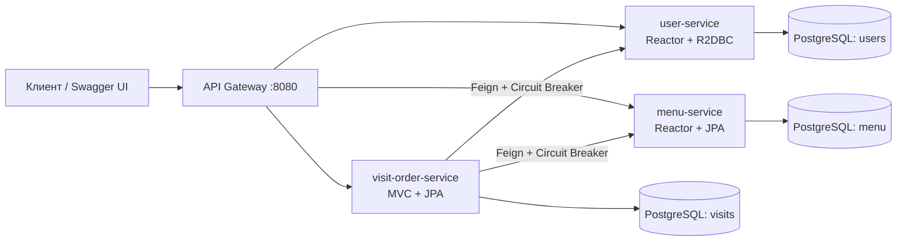

# «Северное сияние» — Cocktail Bar Backend

**Лабораторная работа №2 · Высоконагруженные системы · Микросервисная архитектура на Spring Boot**

«Северное сияние» — серверная часть информационной системы коктейльного бара. Приложение позволяет вести учёт посетителей, управлять коктейльным меню, фиксировать посещения, подбирать напитки по вкусовым предпочтениям и оформлять заказы.

Во второй лабораторной монолит из [лабораторной №1](../lab_1) разделён на три бизнес-микросервиса. Проект написан на **Kotlin** с использованием **Spring Boot**, **Spring Cloud**, **Project Reactor** и **PostgreSQL**. Для пользователей используется реактивный доступ к данным через **R2DBC**, для меню — **Reactor совместно со Spring Data JPA**, для посещений и заказов — **Spring MVC и JPA**.

Сервисы получают настройки из **Config Server**, регистрируются в **Eureka** и доступны через **Spring Cloud Gateway**. Межсервисные запросы выполняются через **Feign Client** с **Circuit Breaker**.

## Содержание

- [1. Техническое задание](#1-техническое-задание)
- [2. Описание разработанной системы](#2-описание-разработанной-системы)
- [3. Технологический стек](#3-технологический-стек)
- [4. Функциональные возможности](#4-функциональные-возможности)
- [5. Архитектура приложения](#5-архитектура-приложения)
- [6. Структура баз данных](#6-структура-баз-данных)
- [7. REST API](#7-rest-api)
- [8. Пагинация и рекомендации](#8-пагинация-и-рекомендации)
- [9. Транзакции](#9-транзакции)
- [10. Валидация и обработка ошибок](#10-валидация-и-обработка-ошибок)
- [11. Запуск приложения](#11-запуск-приложения)
- [12. Тестирование и покрытие](#12-тестирование-и-покрытие)
- [13. Организация разработки](#13-организация-разработки)

## 1. Техническое задание

**Лабораторная работа №2**

**Источник:** [Discipliny/highload_systems](https://github.com/Discipliny/highload_systems#лабораторная-работа-2)

Декомпозировать на микросервисы разработанную систему из лабораторной работы 1.

- Микросервисы должны регистрироваться в [Eureka](https://spring.io/projects/spring-cloud-netflix).
- Микросервисы должны подтягивать конфигурацию из [Config Server](https://spring.io/projects/spring-cloud-config).
- Микросервисы должны быть доступны через [Spring Gateway](https://spring.io/projects/spring-cloud-gateway).
- Для взаимодействия между микросервисами использовать Feign Client.
- Внедрить [Circuit Breaker](https://cloud.spring.io/spring-cloud-netflix/multi/multi__circuit_breaker_hystrix_clients.html).
- Минимум один микросервис должен быть написан с использованием Reactor и R2DBC.
- Минимум один микросервис должен быть написан с использованием Reactor и Spring Data JPA/JDBC.

При декомпозиции сохранены бизнес-сценарии первой лабораторной, публичные REST-маршруты, DTO, валидация, миграции, транзакции, пагинация и общая интерактивная документация. Система собирается и запускается через Docker Compose. Для бизнес-модулей проверяется покрытие тестами не менее **70%** строк и инструкций.

### Соответствие требованиям

| Требование | Реализация в проекте | Подтверждение |
| --- | --- | --- |
| Eureka | Три бизнес-сервиса, Gateway и Config Server регистрируются в `discovery-service` | Пять клиентов со статусом `UP` в Eureka Dashboard |
| Config Server | Клиенты используют обязательный импорт `configserver:`; внешний репозиторий разделён по директориям | Настройки портов, БД, маршрутов и Circuit Breaker выдаются из `config-repository` |
| Spring Cloud Gateway | Общая точка входа, маршруты `lb://` к бизнес-сервисам | REST API и Swagger доступны через порт `8080` |
| Feign Client | `UserClient` и `MenuClient` в `visit-order-service` | Реальные вызовы при открытии посещения, создании заказа, подборе рекомендаций и удалении записей |
| Circuit Breaker | Spring Cloud Circuit Breaker с Resilience4j оборачивает Feign | `FeignCircuitBreakerIT` проверяет открытие, прекращение HTTP-вызовов и восстановление |
| Reactor + R2DBC | `user-service`: WebFlux, `Mono`, `ReactiveCrudRepository`, PostgreSQL R2DBC | CRUD и реактивные транзакции проверяются с PostgreSQL в Testcontainers |
| Reactor + JPA | `menu-service`: WebFlux, `Mono`/`Flux`, JPA на `boundedElastic` | Транзакция и преобразование в DTO выполняются внутри отложенной задачи; есть модульные и интеграционные тесты |

## 2. Описание разработанной системы

Предметная область — коктейльный бар. Один клиент может посещать бар многократно, во время каждого посещения выбирать вкусовые предпочтения и получать подходящие рекомендации. Официант оформляет заказ, а сотрудник бара назначается ответственным за его приготовление. Стоимость заказа рассчитывается автоматически.

Основные сущности системы:

| Сущность | Назначение | Сервис-владелец |
| --- | --- | --- |
| `User` | Посетитель или сотрудник бара | `user-service` |
| `MenuItem` | Коктейль, его стоимость, состав и вкусовые характеристики | `menu-service` |
| `TasteTag` | Вкусовой тег коктейля | `menu-service` |
| `Visit` | Посещение конкретного клиента | `visit-order-service` |
| `Order` | Заказ, связанный с посещением и сотрудниками | `visit-order-service` |
| `OrderItem` | Позиция заказа с количеством и зафиксированной ценой | `visit-order-service` |

**Роли пользователей:**

- `CLIENT` — посетитель бара;
- `WAITER` — официант, который оформляет заказ;
- `WORKER` — сотрудник бара, выполняющий заказ.

При создании пользователя через REST API ему автоматически назначается роль `CLIENT`. При оформлении заказа проверяются роли `WAITER` и `WORKER`. Отдельного API назначения ролей, аутентификации и JWT-авторизации в лабораторной №2 нет: роли используются для бизнес-проверок.

**Вкусовые категории:** `SWEET`, `SOUR`, `BITTER`, `SALTY`, `SPICY`. Предпочтения выбираются для конкретного посещения и очищаются при его закрытии.

## 3. Технологический стек

| Компонент | Реализация |
| --- | --- |
| Язык | Kotlin 2.3.21 |
| Платформа | Java 21 |
| Фреймворк | Spring Boot 4.1.1 |
| Микросервисная инфраструктура | Spring Cloud 2025.1.4 |
| Сборка | Maven 3.9.16, Maven Wrapper, многомодульный проект |
| Обнаружение сервисов | Spring Cloud Netflix Eureka |
| Централизованная конфигурация | Spring Cloud Config Server, файловый `native`-репозиторий |
| Маршрутизация | Spring Cloud Gateway Server WebFlux |
| Межсервисное взаимодействие | Spring Cloud OpenFeign, Spring Cloud LoadBalancer |
| Устойчивость к отказам | Spring Cloud Circuit Breaker, Resilience4j |
| Реактивное программирование | Project Reactor: `Mono`, `Flux` |
| HTTP API | Spring WebFlux в `user-service` и `menu-service`; Spring Web MVC в `visit-order-service` |
| Доступ к данным | Spring Data R2DBC; Spring Data JPA, Hibernate |
| Базы данных | PostgreSQL 17, отдельная БД каждого бизнес-сервиса |
| Миграции БД | Flyway |
| Валидация | Jakarta Bean Validation |
| Документация API | OpenAPI 3, общий Swagger UI, springdoc-openapi 3.1.0 |
| Тестирование | JUnit Jupiter, Mockito, Reactor Test, Testcontainers |
| Покрытие | JaCoCo 0.8.15 |
| Контейнеризация | Docker, Docker Compose |
| Версионирование | Git, GitHub, feature branches, Conventional Commits |

## 4. Функциональные возможности

### 4.1. Пользователи

Реализованы создание, получение по идентификатору, обновление и удаление пользователей. Проверяется уникальность электронной почты; имя и email проходят валидацию. При создании присваивается роль `CLIENT`. Отдельный эндпоинт получения всех пользователей не предусмотрен.

Пользователя нельзя удалить, если на него ссылаются посещения или заказы. Проверка выполняется в `visit-order-service`, а удаление свободной записи — в `user-service` через Feign.

### 4.2. Коктейльное меню

Реализован CRUD для коктейлей. Для каждой позиции указываются название, цена, ингредиенты и вкусовые теги. Один коктейль может иметь несколько тегов, а один тег — относиться к нескольким коктейлям.

Миграции Flyway добавляют **5 вкусовых тегов и 28 коктейлей** из первой лабораторной. Меню поддерживает постраничную загрузку по 10 позиций. Удаление коктейля, который уже входит в заказ, возвращает `409 Conflict`.

### 4.3. Посещения

Посещение содержит идентификатор клиента, номер столика, время открытия, статус `OPEN`/`CLOSED`, время закрытия и временные вкусовые предпочтения.

Реализованы открытие посещения, получение по ID, получение списка, изменение номера столика, изменение предпочтений и закрытие. При закрытии фиксируется время завершения и очищаются предпочтения. Изменение закрытого посещения запрещено.

### 4.4. Рекомендации коктейлей

Рекомендации формируются для конкретного открытого посещения. `visit-order-service` проверяет посещение и передаёт его вкусовые предпочтения в `menu-service` через Feign. Меню выполняет запрос к своей БД и возвращает не более **50 коктейлей**, совпадающих хотя бы по одному вкусовому тегу.

При отсутствии предпочтений возвращается пустой список. При недоступности сервиса меню возвращается ошибка `503`, а не пустой результат рекомендаций.

### 4.5. Заказы

Заказ создаётся только для открытого посещения. При оформлении выполняются проверки:

1. Посещение существует и имеет статус `OPEN`.
2. Официант и работник бара существуют в `user-service`.
3. Роли сотрудников соответствуют `WAITER` и `WORKER`.
4. Выбранные позиции существуют в `menu-service`, а количество напитков корректно.
5. Итоговая сумма рассчитывается из текущих цен меню и количества напитков.

Каждая позиция сохраняет `quantity` и **`unitPrice` — цену на момент покупки**. Последующее изменение цены меню не меняет историческую стоимость заказа. Название коктейля при чтении заказа запрашивается актуальное. Для денежных сумм используется `BigDecimal`.

Реализованы создание заказа и получение по идентификатору.

## 5. Архитектура приложения

### 5.1. Границы микросервисов

| Модуль | Ответственность | HTTP-порт внутри Docker |
| --- | --- | ---: |
| `user-service` | Пользователи и их роли | `8081` |
| `menu-service` | Коктейли, вкусовые теги и поиск меню по вкусам | `8082` |
| `visit-order-service` | Посещения, заказы, предпочтения, рекомендации и проверка ссылок перед удалением | `8083` |
| `config-service` | Выдача внешней конфигурации | `8888` |
| `discovery-service` | Реестр Eureka | `8761` |
| `api-gateway` | Внешние API-маршруты и общий Swagger UI | `8080` |

Посещения и заказы оставлены в одном сервисе, поскольку используют общие бизнес-правила и локальные транзакции. Пользователи и меню имеют собственные данные и отдельные базы.



Config Server выдаёт настройки при запуске. Eureka хранит адреса экземпляров, которые используют Gateway и Feign через LoadBalancer.

### 5.2. Структура проекта

```text
lab_2/
├── api-gateway/
├── config-service/
├── discovery-service/
├── user-service/
│   └── src/
│       ├── main/kotlin/       # Контроллеры, сервис, R2DBC-репозиторий, Entity, DTO
│       ├── main/resources/   # Импорт Config Server и миграции Flyway
│       └── test/kotlin/      # Модульные и интеграционные тесты
├── menu-service/             # Аналогичная структура; Reactor + JPA
├── visit-order-service/      # Посещения, заказы, Feign-клиенты и транзакции
├── config-repository/
│   ├── shared/               # Общие настройки Eureka
│   ├── discovery-service/
│   ├── api-gateway/
│   ├── user-service/
│   ├── menu-service/
│   └── visit-order-service/
├── .env.example
├── pom.xml                  # Родительский POM и список шести модулей
├── mvnw
├── Dockerfile
├── docker-compose.yml
└── compose.test.yml
```

В бизнес-сервисах контроллеры отвечают за приём, валидацию и возврат HTTP-данных. Сервисный слой содержит бизнес-правила и транзакции. Репозитории работают только с БД своего сервиса. Entity и DTO разделены.

### 5.3. Config Server и Eureka

[Config Server](config-service/src/main/resources/application.yml) использует профиль `native` и читает две группы директорий: `shared` и `{application}`. В Docker каталог [config-repository](config-repository) подключается отдельным томом в режиме чтения.

Локальные `application.yml` клиентов содержат имя приложения и обязательный импорт:

```yaml
spring:
  application:
    name: discovery-service
  config:
    import: "configserver:${CONFIG_SERVER_URL:http://localhost:8888}"
```

Внешние конфигурации задают порты, подключения к БД, маршруты Gateway, Eureka и параметры Circuit Breaker. Импорт выполняется без `optional:`, поэтому недоступная обязательная конфигурация не игнорируется.

Config Server запускается со своими локальными настройками: они нужны, чтобы начать выдавать конфигурацию остальным приложениям. Eureka Server получает настройки из Config Server и работает в standalone-режиме: не регистрируется в самом себе. Остальные пять приложений регистрируются в Eureka.

### 5.4. Feign Client и Circuit Breaker

В `visit-order-service` используются два клиента:

- [UserClient](visit-order-service/src/main/kotlin/ru/severnoyesiyanieBack/client/UserClient.kt) — получение пользователей и удаление свободной записи;
- [MenuClient](visit-order-service/src/main/kotlin/ru/severnoyesiyanieBack/client/MenuClient.kt) — получение коктейлей и тегов, подбор рекомендаций и удаление свободной позиции.

В рабочей конфигурации сервисы выбираются по именам из Eureka через Spring Cloud LoadBalancer. В тестах адреса подменяются локальными HTTP-серверами, запросы к которым делает настоящий Feign.

Обычный Spring Cloud OpenFeign не поддерживает реактивные клиенты. Поэтому вызовы выполняются из синхронного MVC-сервиса. `user-service` и `menu-service` сами не вызывают другие сервисы; блокирующий Feign не попадает на их Netty event-loop. Ограничение описано в [документации Spring Cloud OpenFeign](https://docs.spring.io/spring-cloud-openfeign/reference/spring-cloud-openfeign.html#_reactive_support).

Circuit Breaker реализован через **Spring Cloud Circuit Breaker с Resilience4j**. В ТЗ требуется механизм Circuit Breaker; в проекте используется [поддерживаемый Spring Cloud starter Resilience4j](https://docs.spring.io/spring-cloud-circuitbreaker/reference/spring-cloud-circuitbreaker-resilience4j/starters.html).

Параметры находятся в [централизованной конфигурации visit-order-service](config-repository/visit-order-service/visit-order-service.yml):

| Параметр | Значение |
| --- | ---: |
| Окно вызовов | `10` |
| Минимальное число вызовов для оценки | `5` |
| Порог доли отказов | `50%` |
| Ожидание в состоянии `OPEN` | `10s` |
| Пробные вызовы в `HALF_OPEN` | `2` |
| Feign connect timeout | `1000 ms` |
| Feign read timeout | `2000 ms` |

Бизнес-ошибки `4xx` сохраняют статус и исключены из статистики отказов. При недоступности зависимости или открытом Circuit Breaker API возвращает `503 Service Unavailable`. Настройка `disable-thread-pool: true` сохраняет выполнение Feign на потоке MVC-запроса; ожидание ограничивают HTTP-таймауты клиента.

После изменения настроек нужно перезапустить `visit-order-service`, чтобы он получил новую конфигурацию. Автоматическое обновление через Config Bus не используется.

### 5.5. Reactor и доступ к данным

**`user-service` — Reactor + R2DBC.** Контроллеры и сервис возвращают `Mono`, репозиторий наследует `ReactiveCrudRepository`. CRUD выполняется через PostgreSQL R2DBC без блокирующего JDBC. Обновление и удаление используют `TransactionalOperator`. JDBC-драйвер подключён только для миграций Flyway при старте приложения.

**`menu-service` — Reactor + Spring Data JPA.** Контроллеры и сервис используют `Mono`/`Flux`. JPA остаётся блокирующей, поэтому обращение к репозиторию откладывается через `Mono.fromCallable` и выполняется на `Schedulers.boundedElastic()`. `TransactionTemplate` открывает транзакцию внутри этой задачи; загрузка связей и преобразование Entity → DTO заканчиваются до её завершения. Выполненный синхронно запрос не оборачивается в `Mono.just`.

**`visit-order-service` — Spring MVC + JPA.** Синхронные транзакции и Feign выполняются в обычной модели MVC. `ResponseEntity` используется для HTTP-статусов и заголовка `X-Total-Count`; реактивные контроллеры пользователей и меню возвращают `Mono`/`Flux`.

## 6. Структура баз данных

Каждый бизнес-сервис использует собственный PostgreSQL-контейнер, схему миграций и Docker volume. Сервисы не обращаются напрямую к чужим таблицам.

| БД | Основные таблицы | Владелец |
| --- | --- | --- |
| `users` | `users` | `user-service` |
| `menu` | `menu`, `taste_tags`, `menu_taste_tags` | `menu-service` |
| `visits` | `visits`, `orders`, `order_items`, `visit_taste_preferences` | `visit-order-service` |

### Связи между сущностями

- **One-to-Many / Many-to-One:** посещение → заказы; заказ → позиции заказа. Эти связи и внешние ключи остаются внутри БД `visits`.
- **Many-to-Many:** коктейли ↔ вкусовые теги через `menu_taste_tags` внутри БД `menu`.
- **Связь заказов с коктейлями с дополнительными полями:** `order_items` содержит внешний ID коктейля, `quantity` и `unit_price`. После декомпозиции это логическая связь между сервисами, без межбазового внешнего ключа.

В `visits.id_user`, `orders.id_waiter`, `orders.id_worker` и `order_items.id_product` хранятся идентификаторы внешних сущностей. Их существование проверяется через Feign. Прямых JPA-связей с пользователями и меню в `visit-order-service` нет.

`visit_taste_preferences` хранит ID и название выбранного тега как локальные данные посещения. При обновлении предпочтений теги проверяются в `menu-service`.

### Миграции

| Сервис | Миграции |
| --- | --- |
| `user-service` | [V1 — пользователи](user-service/src/main/resources/db/migration/V1__create_users.sql) |
| `menu-service` | [V1 — меню и вкусовые теги](menu-service/src/main/resources/db/migration/V1__create_menu_tables.sql), [V2 — ингредиенты и исходное меню](menu-service/src/main/resources/db/migration/V2__add_ingredients_and_populate_menu.sql) |
| `visit-order-service` | [V1 — посещения, заказы и предпочтения](visit-order-service/src/main/resources/db/migration/V1__create_visit_order_tables.sql) |

Flyway создаёт структуру при запуске. Для JPA установлено `ddl-auto=validate`: Hibernate проверяет схему. Роли пользователей и статусы посещений сохраняются строками; для JPA-статуса используется `EnumType.STRING`, для R2DBC-роли — строковое представление enum.

Первая лабораторная остаётся отдельной реализацией в `lab_1`. Миграции `lab_2` создают новые базы; автоматический перенос накопленных данных монолита не выполняется.

## 7. REST API

Базовый адрес при запуске через Docker Compose: **`http://localhost:8080`**. Все публичные запросы проходят через Gateway.

### Пользователи — `/api/users`

| Метод | Путь | Назначение |
| --- | --- | --- |
| `POST` | `/api/users` | Создать пользователя (`CLIENT`) |
| `GET` | `/api/users/{userId}` | Получить пользователя |
| `PUT` | `/api/users/{userId}` | Изменить имя и email |
| `DELETE` | `/api/users/{userId}` | Проверить ссылки и удалить пользователя |

### Меню — `/api/menu`

| Метод | Путь | Назначение |
| --- | --- | --- |
| `GET` | `/api/menu?page=0` | Получить часть меню, по 10 записей |
| `GET` | `/api/menu/{idPosition}` | Получить коктейль |
| `POST` | `/api/menu` | Добавить коктейль |
| `PUT` | `/api/menu/{idPosition}` | Обновить коктейль |
| `DELETE` | `/api/menu/{idPosition}` | Проверить ссылки и удалить коктейль |

### Посещения и рекомендации — `/api/visits`

| Метод | Путь | Назначение |
| --- | --- | --- |
| `POST` | `/api/visits` | Открыть посещение |
| `GET` | `/api/visits/{id}` | Получить посещение |
| `GET` | `/api/visits?page=0&size=10` | Получить страницу посещений |
| `PUT` | `/api/visits/{id}` | Изменить номер столика |
| `PUT` | `/api/visits/{id}/preferences` | Обновить вкусовые предпочтения |
| `GET` | `/api/visits/{id}/recommendations` | Получить рекомендации |
| `POST` | `/api/visits/{id}/close` | Закрыть посещение |

### Заказы — `/api/orders`

| Метод | Путь | Назначение |
| --- | --- | --- |
| `POST` | `/api/orders` | Оформить заказ |
| `GET` | `/api/orders/{id}` | Получить заказ |

Пример тела запроса на создание заказа:

```json
{
  "visitId": 1,
  "waiterId": 2,
  "workerId": 3,
  "items": [
    { "menuItemId": 1, "quantity": 2 },
    { "menuItemId": 4, "quantity": 1 }
  ]
}
```

Идентификаторы должны существовать; посещение должно быть открыто, а сотрудники — иметь соответствующие роли.

Основные HTTP-статусы: `200 OK`, `201 Created`, `204 No Content`, `400 Bad Request`, `404 Not Found`, `409 Conflict`, `503 Service Unavailable`.

### Интерактивная документация

После запуска системы:

- [Общий Swagger UI](http://localhost:8080/swagger-ui.html);
- [OpenAPI пользователей](http://localhost:8080/openapi/users);
- [OpenAPI меню](http://localhost:8080/openapi/menu);
- [OpenAPI посещений и заказов](http://localhost:8080/openapi/visits-orders).

В Swagger выбирается одна из трёх спецификаций. Все они загружаются через Gateway, и `Try it out` отправляет запросы на его адрес.

Публичные операции удаления пользователей и коктейлей находятся в спецификации **«Посещения и заказы»**, поскольку проверка существующих ссылок выполняется в `visit-order-service`. Публичные URL при этом сохранены. Внутренние `/internal/**` доступны только внутри Docker-сети, не маршрутизируются Gateway и скрыты из OpenAPI.

## 8. Пагинация и рекомендации

| Механизм | Где применяется | Поведение |
| --- | --- | --- |
| `Slice` | `GET /api/menu` | По 10 записей, без общего количества; подходит для бесконечной прокрутки |
| `Page` в сервисном слое | `GET /api/visits` | В теле — список текущей страницы, в заголовке `X-Total-Count` — общее количество |
| Ограниченный запрос | Рекомендации | Не более 50 коктейлей, фильтрация по вкусовым тегам на уровне БД меню |

Для посещений стандартный размер страницы — 10, максимальный — **50**. Переданный размер приводится к диапазону `1..50`; отрицательный номер страницы отклоняется. Для меню размер фиксирован — 10.

Рекомендации учитывают вкусы конкретного открытого посещения. Если выбранных вкусов нет, список пуст. Повторяющиеся совпадения по нескольким тегам исключаются запросом `DISTINCT`.

## 9. Транзакции

Внутри каждого сервиса транзакции относятся к его собственной базе данных. Сетевой вызов Feign не создаёт общую транзакцию между несколькими БД.

### Создание заказа

В `visit-order-service` операция выполняется под `@Transactional`: проверяются посещение и сотрудники, запрашиваются позиции меню, рассчитывается сумма, создаются заказ и все его позиции. При ошибке локальные изменения откатываются, поэтому частично оформленный заказ не сохраняется.

### Закрытие посещения

В одной транзакции посещение переводится в `CLOSED`, устанавливается `closedAt` и очищаются временные вкусовые предпочтения. Эти изменения должны сохраняться согласованно: нельзя закрыть посещение, оставив часть прежнего состояния.

### Обновление меню и пользователей

В `menu-service` `TransactionTemplate` объединяет изменения коктейля и его связей с тегами. Транзакция выполняется на том же worker-потоке, что и JPA-вызовы.

В `user-service` обновление и удаление выполняются через `TransactionalOperator`, который управляет реактивной R2DBC-транзакцией.

### Удаление связанных записей

Перед удалением пользователя или коктейля `visit-order-service` проверяет ссылки в своей БД. Используемая запись возвращает `409 Conflict`; свободная удаляется через внутренний Feign-вызов владельца. Транзакционные advisory locks PostgreSQL согласуют обычные конкурентные удаления и создание ссылок через этот сервис.

**Границы гарантий:** локальная транзакция не откатывает уже выполненное удаление в другом сервисе. При сетевом таймауте результат такого удаления может оставаться неизвестным. Также, как и в первой лабораторной, отдельная блокировка строки или версионирование для гонки «создание заказа одновременно с закрытием посещения» не реализованы. Распределённая ACID-транзакция и полная сериализация этих операций не заявляются.

## 10. Валидация и обработка ошибок

Jakarta Bean Validation применяется на DTO и моделях данных. Проверяются обязательные строки, формат email, длины полей, допустимые цены, количества и непустой состав заказа.

В JPA-сервисах Entity проверяются при сохранении. В `user-service` для R2DBC подключён `BeforeConvertCallback`, который валидирует `User` до записи. Уникальность email дополнительно обеспечивается ограничением БД, в том числе при конкурентных запросах.

`GlobalExceptionHandler` каждого бизнес-сервиса преобразует ошибки в HTTP-ответы с понятным сообщением. Например:

| Ситуация | Статус |
| --- | --- |
| Некорректные поля запроса или неизвестные вкусовые теги | `400 Bad Request` |
| Пользователь, коктейль, посещение или заказ не найден | `404 Not Found` |
| Повторяющийся email, неверная роль сотрудника, изменение закрытого посещения или удаление используемой записи | `409 Conflict` |
| Недоступен вызываемый сервис или открыт Circuit Breaker | `503 Service Unavailable` |

Feign-декодер сохраняет статус и тело бизнес-ошибок удалённого сервиса. Отказы зависимости не подменяются фиктивными пользователями, меню или успешными пустыми ответами.

## 11. Запуск приложения

### 11.1. Docker Compose

Понадобятся **Docker** и **Docker Compose**. Для сборки и запуска всей системы локальные Java и Maven не обязательны: сборка выполняется в Docker.

Клонировать репозиторий и перейти во вторую лабораторную:

```bash
git clone https://github.com/ddanielchik/vps.git
cd vps/lab_2
```

Если репозиторий уже есть, достаточно перейти в его каталог `lab_2`.

При необходимости скопировать пример переменных и изменить значения:

```bash
cp .env.example .env
```

Собрать и запустить систему:

```bash
docker compose -p lab2 up -d --build --wait
```

Compose запускает **9 контейнеров**: 6 приложений и 3 PostgreSQL. Сначала готовится Config Server, затем Eureka и бизнес-сервисы с базами, после них — Gateway. Готовность проверяется healthcheck. Flyway применяет миграции при запуске каждого бизнес-сервиса.

| Адрес | Назначение |
| --- | --- |
| [http://localhost:8080/api/menu](http://localhost:8080/api/menu) | Проверка API через Gateway |
| [http://localhost:8080/swagger-ui.html](http://localhost:8080/swagger-ui.html) | Общий Swagger UI |
| [http://localhost:8761](http://localhost:8761) | Eureka Dashboard |

После старта обновление реестра и клиентских кэшей Eureka может занять около минуты. В Eureka должны отображаться `CONFIG-SERVICE`, `API-GATEWAY`, `USER-SERVICE`, `MENU-SERVICE`, `VISIT-ORDER-SERVICE` со статусом `UP`.

Проверить контейнеры и логи:

```bash
docker compose -p lab2 ps
docker compose -p lab2 logs --tail=100 discovery-service api-gateway
```

Config Server не публикует внешний порт. Проверить выдачу конфигурации можно внутри его контейнера:

```bash
docker compose -p lab2 exec config-service \
  curl -fsS http://localhost:8888/discovery-service/default
```

В ответе должны быть непустые `propertySources`, включая конфигурацию `discovery-service` с `server.port: 8761`.

### 11.2. Переменные окружения и сети

| Переменная в `.env` | Назначение | По умолчанию |
| --- | --- | --- |
| `GATEWAY_PORT` | Внешний порт Gateway | `8080` |
| `EUREKA_PORT` | Внешний порт Eureka | `8761` |
| `USERS_DB_PASSWORD` | Пароль БД пользователей | `users` |
| `MENU_DB_PASSWORD` | Пароль БД меню | `menu` |
| `VISITS_DB_PASSWORD` | Пароль БД посещений и заказов | `visits` |

Compose передаёт приложениям адреса Config Server и Eureka, DNS-имена экземпляров и параметры их БД. Значения паролей по умолчанию предназначены для локальной лабораторной.

**Снаружи доступны только Gateway и Eureka.** Бизнес-сервисы и Config Server подключены к внутренней сети `backend`. Каждая БД имеет отдельную внутреннюю сеть и volume; к сети БД подключается только соответствующий бизнес-сервис. Eureka сообщает клиентам DNS-имена Docker-сервисов, доступные через `backend`.

При одновременном запуске первой и второй лабораторных нужно выбрать свободный `GATEWAY_PORT`, поскольку обе по умолчанию используют `8080`.

### 11.3. Ручная проверка заказов

Через Swagger создать клиента и открыть посещение. Для заказа дополнительно нужны сотрудники с ролями `WAITER` и `WORKER`. Как и в первой лабораторной, их можно добавить непосредственно в БД:

```bash
docker compose -p lab2 exec -T users-db psql -U users -d users <<'SQL'
INSERT INTO users (name, email, role)
VALUES ('Waiter', 'waiter@bar.local', 'WAITER'),
       ('Worker', 'worker@bar.local', 'WORKER')
ON CONFLICT (email) DO NOTHING;

SELECT id_user, name, role FROM users
WHERE email IN ('waiter@bar.local', 'worker@bar.local');
SQL
```

Использовать возвращённые ID в запросе заказа. Начальные ID тегов: `1 — SWEET`, `2 — SOUR`, `3 — BITTER`, `4 — SALTY`, `5 — SPICY`.

### 11.4. IntelliJ IDEA и остановка

Для работы с кодом импортировать [pom.xml](pom.xml) как Maven-проект, выбрать **JDK 21** и выполнить Reload All Maven Projects. IDEA должна увидеть все шесть модулей. Сборка из терминала использует Maven Wrapper `./mvnw`.

Остановить систему с сохранением данных:

```bash
docker compose -p lab2 down
```

Команда `docker compose -p lab2 down -v` дополнительно удаляет volumes и **все данные трёх БД этого Compose-проекта**.

## 12. Тестирование и покрытие

### 12.1. Модульные и интеграционные тесты

Используются **JUnit Jupiter**, **Mockito**, **Reactor Test** и **PostgreSQL в Testcontainers**. Для интеграционных тестов нужен работающий Docker.

Из каталога `lab_2` при установленной Java 21:

```bash
./mvnw clean verify
```

Те же проверки можно выполнить в Maven-контейнере:

```bash
docker compose -p lab2-tests -f compose.test.yml run --rm tests
```

Surefire запускает модульные тесты, Failsafe — интеграционные. JaCoCo объединяет покрытие и на этапе `verify` проверяет **не менее 70% строк и не менее 70% инструкций** в каждом бизнес-модуле. В инфраструктурные сервисы JaCoCo и пустые тестовые классы не добавлены.

Проверяются:

- CRUD, DTO, Entity-валидация, ошибки и уникальность email;
- PostgreSQL, миграции и исходное меню;
- пагинация и ограничение количества записей;
- бизнес-правила посещений, заказов и рекомендаций;
- откат транзакций при ошибке;
- запрет удаления связанных данных и согласование конкурентных операций;
- HTTP-контракты настоящих Feign-клиентов;
- Circuit Breaker: ошибки `4xx` не считаются отказами, `OPEN` прекращает HTTP-вызовы, после пробного вызова возможен возврат в `CLOSED`.

В интеграционных тестах `visit-order-service` удалённые сервисы представлены тестовыми HTTP-серверами; PostgreSQL запускается в Testcontainers. Проверка настоящей регистрации Eureka и маршрутов Gateway выполняется отдельно на Compose-системе.

### 12.2. Результаты и отчёты

Последний полный успешный прогон: **127 тестов**, без ошибок, падений и пропусков; проверка порогов JaCoCo пройдена.

| Модуль | Тесты | Покрытие строк | Покрытие инструкций |
| --- | ---: | ---: | ---: |
| `user-service` | 20 | 96,10% | 88,57% |
| `menu-service` | 27 | 97,64% | 89,33% |
| `visit-order-service` | 80 | 99,09% | 94,37% |

Это результаты конкретного прогона, а не автоматически обновляемый счётчик. После изменения кода нужно повторить `verify`.

HTML-отчёты формируются относительно `lab_2`:

```text
user-service/target/site/jacoco/index.html
menu-service/target/site/jacoco/index.html
visit-order-service/target/site/jacoco/index.html
```

### 12.3. Демонстрация всей системы через Swagger

Работа бизнес-сценариев демонстрируется в [общем Swagger UI](http://localhost:8080/swagger-ui.html), как в первой лабораторной. В списке **Select a definition** выбирается «Пользователи», «Меню» или «Посещения и заказы». Для каждого запроса нажать **Try it out → Execute**. Адрес `Request URL` должен вести на Gateway: `http://localhost:8080/api/...`.

Перед демонстрацией запустить Compose и подготовить официанта и работника бара по разделу 11.3. Их ID взять из результата SQL-запроса. Создаваемые через Swagger пользователи получают роль `CLIENT`; API назначения ролей не предусмотрен.

| Шаг | Действие в Swagger | Ожидаемый результат |
| --- | --- | --- |
| 1 | «Пользователи»: `POST /api/users`, затем `GET` и `PUT /api/users/{userId}` | Создание — `201`, чтение и обновление — `200`; сохранить `idUser` |
| 2 | Повторить создание с тем же email; отдельно отправить пустое имя или некорректный email | Дубликат — `409`, ошибка валидации — `400` |
| 3 | «Меню»: `POST /api/menu`, затем `GET /api/menu/{idPosition}` | Создание — `201`, чтение — `200`; сохранить `idPosition` |
| 4 | «Меню»: `GET /api/menu?page=0`, затем `page=1` | Разные части меню, до 10 записей в каждой, без `totalElements` |
| 5 | «Посещения и заказы»: `POST /api/visits` с ID клиента, затем `PUT /api/visits/{id}` | Открытое посещение создано с `201`, номер столика изменён с `200`; сохранить `idVisit` |
| 6 | `PUT /api/visits/{id}/preferences`, затем `GET /api/visits/{id}/recommendations` | Предпочтения сохранены; рекомендации содержат коктейли с выбранными вкусами, не более 50 |
| 7 | `POST /api/orders` с ID посещения, сотрудников и коктейля; затем `GET /api/orders/{id}` | Заказ создан с `201`, сумма рассчитана; чтение — `200` |
| 8 | «Меню»: изменить цену заказанного коктейля через `PUT`; снова получить заказ в «Посещения и заказы» | В меню новая цена, в заказе прежние `unitPrice` и итоговая сумма |
| 9 | `GET /api/visits?page=0&size=100` | В теле не более 50 записей; общее количество находится в **Response headers → x-total-count** |
| 10 | В «Посещения и заказы» удалить клиента этого посещения и коктейль этого заказа через публичные `DELETE` | Оба запроса возвращают `409`: используемые записи защищены |
| 11 | `POST /api/visits/{id}/close`, затем `GET /api/visits/{id}` и попытка изменить столик | Статус `CLOSED`, заполнено `closedAt`, предпочтения пусты; изменение возвращает `409` |

Пример создания клиента — при повторной демонстрации использовать новый email:

```json
{
  "name": "Анна",
  "email": "anna@example.com"
}
```

Пример коктейля:

```json
{
  "name": "Cuba Libre Sprite",
  "price": 450.00,
  "ingredients": "Ром, Sprite, лимонный сок, лёд",
  "tasteTagIds": [1, 2]
}
```

Для открытия посещения передать `clientId` из ответа создания клиента и положительный `tableNumber`. Для предпочтений передать `{"tasteTagIds": [1, 2]}`. Тело заказа приведено в разделе 7: заменить все ID на полученные во время демонстрации. При обновлении коктейля передавать все поля, как при создании.

Чтобы показать успешное удаление, создать отдельного пользователя без посещений и отдельный коктейль без заказов. Их публичные `DELETE` находятся в «Посещения и заказы» и возвращают `204`; последующее чтение в соответствующей спецификации — `404`.

### 12.4. Отказ зависимости и восстановление

Создать через Swagger отдельное **открытое посещение с непустыми вкусовыми предпочтениями**. Выполнить `GET /api/visits/{id}/recommendations` и получить `200`: этот маршрут обращается к меню через Feign и Circuit Breaker.

Остановить сервис меню из терминала в каталоге `lab_2`:

```bash
docker compose -p lab2 stop menu-service
```

Повторить запрос рекомендаций в Swagger: ожидается `503 Service Unavailable`. Чтение пользователя через `GET /api/users/{userId}` продолжает возвращать `200`. Посещение оставлять открытым: закрытое посещение вернёт бизнес-ошибку `409` ещё до обращения к меню.

Вернуть сервис:

```bash
docker compose -p lab2 start menu-service
```

Дождаться готовности сервиса, его регистрации в Eureka и окончания интервала `OPEN`, если Circuit Breaker успел открыться. Повторный запрос рекомендаций должен снова вернуть `200`.

Сам по себе `503` не доказывает открытие Circuit Breaker. Его состояния отдельно проверяет [FeignCircuitBreakerIT](visit-order-service/src/test/kotlin/ru/severnoyesiyanieBack/integration/FeignCircuitBreakerIT.kt): после отказов подтверждается `OPEN` и отсутствие лишнего HTTP-вызова, затем тест вручную переводит breaker в `HALF_OPEN` и проверяет успешное восстановление `CLOSED`.

Для показа инфраструктуры открыть [Eureka Dashboard](http://localhost:8761), проверить пять регистраций `UP`, выполнить команду проверки Config Server из раздела 11.1 и показать `docker compose -p lab2 ps`: наружу опубликованы только порты Gateway и Eureka. Сам бизнес-сценарий выполняется через Swagger.

## 13. Организация разработки

Разработка ведётся с использованием **git feature branching strategy**. Изменения декомпозиции, Docker, проверок и документации фиксируются отдельными этапами. Сообщения коммитов оформляются по [Conventional Commits](https://www.conventionalcommits.org/en/v1.0.0/): `feat`, `fix`, `refactor`, `test`, `docs`, `chore`.

Архитектура разделяет HTTP-слой, бизнес-логику и доступ к данным. Сервисы имеют собственные области ответственности и БД; инфраструктурные модули содержат только необходимые для своей роли компоненты. Решения ориентированы на SOLID, DRY и KISS.

Репозиторий [`vps`](https://github.com/ddanielchik/vps) содержит отдельные каталоги лабораторных работ. `lab_1` сохраняет монолитную реализацию, `lab_2` содержит её микросервисную декомпозицию. Функциональность лабораторных №3 и №4 в эту работу не включена.

---

**Исходное задание:** [Discipliny/highload_systems](https://github.com/Discipliny/highload_systems)

**Реализация:** [ddanielchik/vps/lab_2](https://github.com/ddanielchik/vps/tree/main/lab_2)
