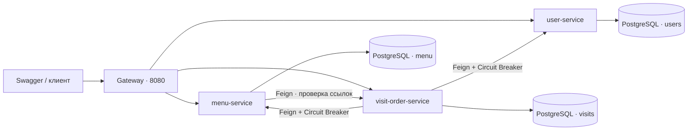

# Лабораторная работа №2

Декомпозировать на микросервисы разработанную систему из лабораторной работы 1.

 - Микросервисы должны регистрироваться в [Eureka](https://spring.io/projects/spring-cloud-netflix).
 - Микросервисы должны подтягивать конфигурацию из [Config-Server](https://spring.io/projects/spring-cloud-config).
 - Микросервисы должны быть доступны через [Spring Gateway](https://spring.io/projects/spring-cloud-gateway).
 - Для взаимодействия между микросервисами использовать Feign Client.
 - Внедрить [Circuit Breaker](https://cloud.spring.io/spring-cloud-netflix/multi/multi__circuit_breaker_hystrix_clients.html).
 - Минимум один микросервис должен быть написан с использованием Reactor и R2DBC.
 - Минимум один микросервис должен быть написан с использованием Reactor и Spring Data JPA/JDBC.

## Общие условия задания

Использовать стабильные версии фреймворков, библиотек, языков. При написании придерживаться языковым конвенциям [Java](https://www.oracle.com/java/technologies/javase/codeconventions-contents.html), [Kotlin](https://kotlinlang.org/docs/coding-conventions.html).

Следовать принципам разработки ПО, таким к SOLID, DRY, KISS и др.

При разработке использовать git feature branching strategy. При выборе имен для коммитов необходимо придерживаться [conventional commits](https://www.conventionalcommits.org/en/v1.0.0/).

Код должен быть покрыт модульными и интеграционными тестами с помощью testcontainers и junit-jupiter-api, берём лучше [отсюда](https://se.ifmo.ru/courses/testing), ещё можно зайти [сюда](https://docs.google.com/presentation/d/1tcPapWwmrAb0Ju88OILOAiOShcTVbHrvw9ZFii2bLpI/edit?usp=sharing). Минимальный общий процент покрытия кода тестами 70%.

Всё должно запускаться через docker compose.

## Реализация требований

Серверная часть коктейльного бара на **Kotlin и Java 21**. Монолит из [лабораторной №1](../lab_1) разделён на три бизнес-сервиса для пользователей, меню и оформления посещений и заказов. Через API можно открыть посещение, подобрать коктейли по вкусу и оформить заказ.

[Запуск](#быстрый-запуск) · [Архитектура](#архитектура) · [Сценарий в Swagger](#проверка-в-swagger) · [Автоматические тесты](#автоматические-тесты)

| Требование | Где реализовано | Как проверить |
| --- | --- | --- |
| Регистрация в Eureka | [`discovery-service`](discovery-service) ведёт реестр. Gateway и три бизнес-сервиса используют [общую конфигурацию Eureka](config-repository/shared/application.yml). Config Server стартует самостоятельно. | Откройте Eureka после [запуска](#быстрый-запуск) и найдите четыре приложения со статусом `UP`. |
| Конфигурация из Config Server | [`config-service`](config-service) читает [`config-repository`](config-repository). Gateway, Eureka и бизнес-сервисы загружают настройки через `spring.config.import`. | Проверьте ответ Config Server командой из раздела [«Где смотреть настройки»](#где-смотреть-настройки). |
| Доступ через Spring Gateway | [Маршруты Gateway](config-repository/api-gateway/application.yml) направляют запросы `/api/v1/...` к сервисам по именам из Eureka. Там же настроен общий Swagger UI. | В Swagger выберите спецификацию и выполните запрос. В **Request URL** будет адрес Gateway на порту `8080` и префикс `/api/v1`. |
| Вызовы через Feign Client | Сервис посещений использует [`UserClient` и `MenuClient`](visit-order-service/src/main/kotlin/ru/severnoyesiyanieBack/client). Сервис меню использует [`VisitOrderClient`](menu-service/src/main/kotlin/ru/severnoyesiyanieback/menu/client/VisitOrderClient.kt). Все три клиента используют Reactive Feign. | Откройте посещение и получите рекомендации по [шагам 2–3](#2-открыть-посещение). Эти запросы обращаются к пользователям и меню. |
| Circuit Breaker | [Настройки Resilience4j](config-repository/visit-order-service/application.yml) применяются к вызовам из сервиса посещений. | В [шаге 5](#5-остановить-меню-и-проверить-восстановление) проверьте ответы `200 → 503 → 200`. Тест `FeignCircuitBreakerIT` проверяет срабатывание Circuit Breaker. |
| Reactor и R2DBC | [`user-service`](user-service) использует WebFlux и [реактивный репозиторий](user-service/src/main/kotlin/ru/severnoyesiyanieback/user/repository/UserRepository.kt). | Выполните создание и чтение пользователя в [шаге 1](#1-создать-пользователя). Работу репозитория с PostgreSQL проверяет `UserApiIT`. |
| Reactor и Spring Data JPA/JDBC | [`menu-service`](menu-service) сочетает WebFlux с [JPA-репозиторием](menu-service/src/main/kotlin/ru/severnoyesiyanieback/menu/repository/MenuItemRepository.kt). Блокирующие запросы к БД выполняются на `boundedElastic`. | Запросите теги и рекомендации в Swagger по [шагу 3](#3-сохранить-вкусы-и-получить-рекомендации). Поведение меню с PostgreSQL проверяет `MenuApiIT`. |

### Общие условия разработки

| Условие | Где посмотреть |
| --- | --- |
| Стабильные версии и конвенции Kotlin и Java | Версии Java, Kotlin, Spring Boot и Spring Cloud заданы в [родительском `pom.xml`](pom.xml). Сборка и запуск контейнеров используют Java 21, версии образов заданы в [Dockerfile](Dockerfile). Код сервисов написан на Kotlin. |
| SOLID, DRY, KISS | Контроллеры принимают HTTP-запросы, сервисы выполняют бизнес-операции, репозитории работают с БД. Общие настройки вынесены в [`shared/application.yml`](config-repository/shared/application.yml). |
| Feature branching и Conventional Commits | Изменения второй лабы ведутся в ветке `feature/lab2-reactive-feign`. Пример сообщения из истории — `docs(lab2): describe architecture setup and verification`. |
| Модульные и интеграционные тесты, покрытие от 70% | Тесты на JUnit Jupiter и Testcontainers лежат в `src/test` бизнес-модулей. `./mvnw clean verify` запускает проверки, в том числе порог JaCoCo. См. [«Автоматические тесты»](#автоматические-тесты). |
| Запуск через Docker Compose | [`docker-compose.yml`](docker-compose.yml) поднимает весь стенд. Команды запуска и адреса сервисов приведены ниже. |

## Быстрый запуск

Запустите Docker Desktop. Из корня репозитория выполните:

```bash
cd lab_2
docker compose -p lab2 up -d --build
docker compose -p lab2 ps
```

| Куда зайти | Что проверить |
| --- | --- |
| [Swagger UI](http://localhost:8080/swagger-ui/index.html) | В **Select a definition** доступны «Пользователи», «Меню» и «Посещения и заказы». |
| [Eureka](http://localhost:8761) | `API-GATEWAY`, `USER-SERVICE`, `MENU-SERVICE` и `VISIT-ORDER-SERVICE` зарегистрированы со статусом `UP`. |

После старта дайте сервисам зарегистрироваться и обновить кэш Eureka. Если Swagger возвращает `503`, сначала проверьте регистрацию и логи.

```bash
docker compose -p lab2 logs --tail=80 api-gateway discovery-service
```

Чтобы остановить стенд с сохранением данных, выполните `docker compose -p lab2 down`. Для работы с кодом откройте [родительский POM](pom.xml) как Maven-проект в IntelliJ IDEA и выберите JDK 21.

## Архитектура



| Модуль | Ответственность |
| --- | --- |
| [`api-gateway`](api-gateway) | Обслуживает Swagger UI и принимает REST-запросы. Маршруты `/api/v1/...` направляются к сервисам по именам из Eureka. |
| [`discovery-service`](discovery-service) | Реестр Eureka. Хранит адреса Gateway и трёх бизнес-сервисов. |
| [`config-service`](config-service) | Выдаёт настройки из [`config-repository`](config-repository). Общие параметры Eureka хранятся в `shared`, настройки каждого приложения — в его каталоге. |
| [`user-service`](user-service) | Пользователи, роли, блокировка и восстановление. Spring WebFlux, Reactor и реактивный доступ к PostgreSQL через R2DBC. |
| [`menu-service`](menu-service) | Коктейли, теги и поиск по вкусам. Spring WebFlux и Reactor, JPA-запросы выполняются на `boundedElastic`. |
| [`visit-order-service`](visit-order-service) | Посещения, предпочтения и заказы. Spring MVC и JPA. Сохраняет название и цену коктейля в позиции заказа. |

У каждого бизнес-сервиса своя БД и миграции Flyway. В посещениях и заказах хранятся ID пользователей и коктейлей из других сервисов. При создании заказа сервис проверяет открытое посещение и роли сотрудников, загружает меню через Feign и сохраняет заказ с позициями в одной локальной транзакции.

**Как формируются рекомендации.** `PUT /api/v1/visits/{id}/preferences` принимает ID вкусовых тегов. Сервис посещений получает их названия через `/api/v1/menu/tags` и сохраняет предпочтения. При `GET /api/v1/visits/{id}/recommendations` он передаёт названия в сервис меню и получает до 50 совпадающих коктейлей.

### Где смотреть настройки

- [Маршруты Gateway и список спецификаций Swagger](config-repository/api-gateway/application.yml).
- [Общие параметры Eureka и профиль `reactive-feign`](config-repository/shared/application.yml). Профиль подключают меню и сервис посещений.
- [Параметры Circuit Breaker](config-repository/visit-order-service/application.yml). Resilience4j временно ограничивает обращения к сервису после серии сбоев и пропускает пробные запросы для проверки восстановления.

Config Server работает на внутреннем порту `8888`. Посмотреть, что он отдаёт клиенту, можно из контейнера:

```bash
docker compose -p lab2 exec config-service curl -fsS http://localhost:8888/discovery-service/default
```

В ответе `propertySources` содержит настройки `discovery-service`, в том числе порт `8761`.

## Проверка в Swagger

Откройте [Swagger UI](http://localhost:8080/swagger-ui/index.html). Выбирайте нужную спецификацию в **Select a definition**, раскройте ручку и нажимайте **Try it out → Execute**. Код и тело ответа показаны в **Server response**. Подставляйте ID из своих ответов вместо чисел в примерах.

### 1. Создать пользователя

В «Пользователи» вызовите `POST /api/v1/users`.

```json
{
  "name": "Анна",
  "email": "anna@example.com"
}
```

Ожидается `201`, роль `CLIENT` и статус `ACTIVE`. Сохраните `idUser`. При повторном создании используйте новый email. Прочитайте созданную запись через `GET /api/v1/users/{userId}`.

### 2. Открыть посещение

В «Посещения и заказы» вызовите `POST /api/v1/visits`. В `clientId` передайте `idUser` из первого шага.

```json
{
  "clientId": 1,
  "tableNumber": 5
}
```

Ожидается `201` и статус `OPEN`. Сохраните `idVisit`. Сервис посещений проверяет пользователя через Feign.

### 3. Сохранить вкусы и получить рекомендации

1. В «Меню» откройте `GET /api/v1/menu/tags` и добавьте к параметру `ids` значения `1` и `2`. На начальных данных ответ `200` содержит теги `SWEET` и `SOUR`. Это поиск в справочнике по ID. Предпочтения для конкретного посещения сохраняются в следующем запросе.
2. В «Посещения и заказы» вызовите `PUT /api/v1/visits/{id}/preferences` с вашим `idVisit` и телом ниже. Ожидается `200` с сохранёнными предпочтениями.
3. Вызовите `GET /api/v1/visits/{id}/recommendations`. Ожидается `200` и массив коктейлей. Скопируйте `idPosition` одного коктейля для заказа.

```json
{
  "tasteTagIds": [1, 2]
}
```

### 4. Оформить заказ

Для заказа нужны действующие сотрудники с ролями `WAITER` и `WORKER`. Их можно подготовить один раз в локальной БД. Команда выведет `id_user` каждого сотрудника.

```bash
docker compose -p lab2 exec -T users-db psql -U users -d users <<'SQL'
INSERT INTO users (name, email, role)
VALUES ('Waiter', 'waiter@bar.local', 'WAITER'),
       ('Worker', 'worker@bar.local', 'WORKER')
ON CONFLICT (email) DO NOTHING;

SELECT id_user, role, status FROM users
WHERE email IN ('waiter@bar.local', 'worker@bar.local');
SQL
```

В Swagger вызовите `POST /api/v1/orders`. Подставьте `idVisit`, ID сотрудников и `idPosition` коктейля. `quantity` — количество.

```json
{
  "visitId": 1,
  "waiterId": 2,
  "workerId": 3,
  "items": [{ "menuItemId": 1, "quantity": 2 }]
}
```

Ожидается `201`. Проверьте цену, количество и итоговую сумму в ответе, затем запросите `GET /api/v1/orders/{id}` с полученным `idOrder`.

### 5. Остановить меню и проверить восстановление

Оставьте посещение открытым с сохранёнными вкусами. Выполните `GET /api/v1/visits/{id}/recommendations` и убедитесь, что ответ `200`. Затем остановите сервис из терминала:

```bash
docker compose -p lab2 stop menu-service
```

Повторите тот же запрос в Swagger несколько раз. Ожидается `503 Service Unavailable`. Запустите меню обратно:

```bash
docker compose -p lab2 start menu-service
```

Дождитесь статуса `UP` в Eureka и обновления реестра у клиентов, затем повторите запрос. Ожидается `200` с коктейлями. Swagger показывает HTTP-результат, а переходы Circuit Breaker и количество обращений к сервису проверяет [FeignCircuitBreakerIT](visit-order-service/src/test/kotlin/ru/severnoyesiyanieBack/integration/FeignCircuitBreakerIT.kt).

### 6. Заблокировать и восстановить пользователя

1. В «Пользователи» выполните `DELETE /api/v1/users/{userId}`. Ответ `204`. Чтение того же пользователя возвращает прежний ID со статусом `BLOCKED`.
2. Повторите `POST /api/v1/visits` с этим `clientId`. Ожидается `409`. Предыдущее посещение доступно через `GET /api/v1/visits/{id}`.
3. Вызовите `PUT /api/v1/users/{userId}` и передайте текущее имя, email и статус `ACTIVE`. После восстановления новое посещение снова открывается с `201`.

```json
{
  "name": "Анна",
  "email": "anna@example.com",
  "status": "ACTIVE"
}
```

В конце закройте первое посещение из шага 2 через `POST /api/v1/visits/{id}/close`. Ожидается `200`, статус `CLOSED` и заполненное `closedAt`.

## Автоматические тесты

Из `lab_2` с JDK 21 и работающим Docker:

```bash
./mvnw clean verify
```

Для запуска из Maven-контейнера:

```bash
docker compose -p lab2-tests -f compose.test.yml run --rm tests
```

Surefire запускает модульные тесты, Failsafe — интеграционные с PostgreSQL в Testcontainers. На этапе `verify` JaCoCo проверяет минимум **70% покрытия строк и инструкций** в каждом бизнес-модуле. HTML-отчёт создаётся в `target/site/jacoco/index.html` внутри `user-service`, `menu-service` и `visit-order-service`.
